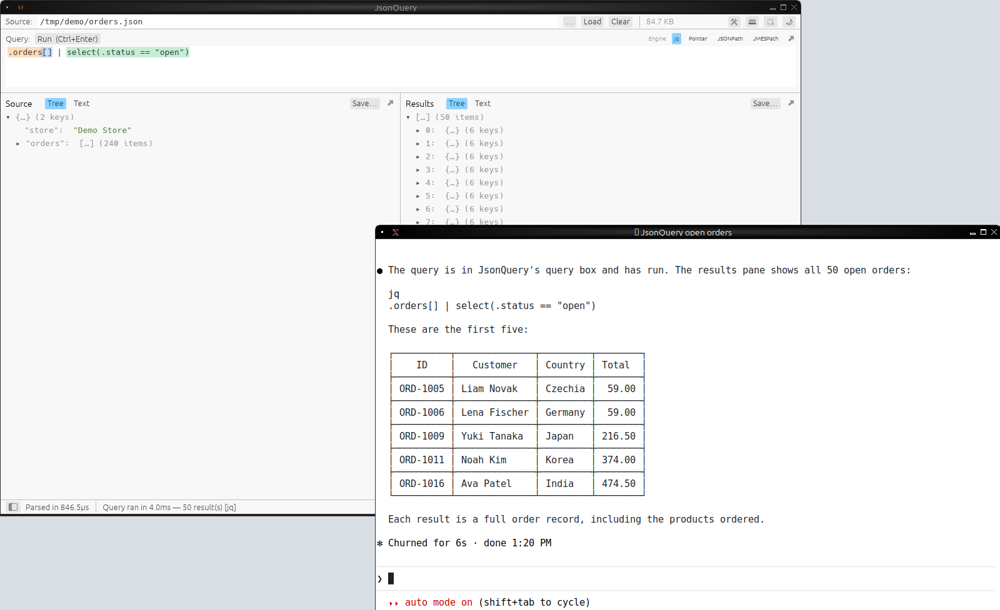
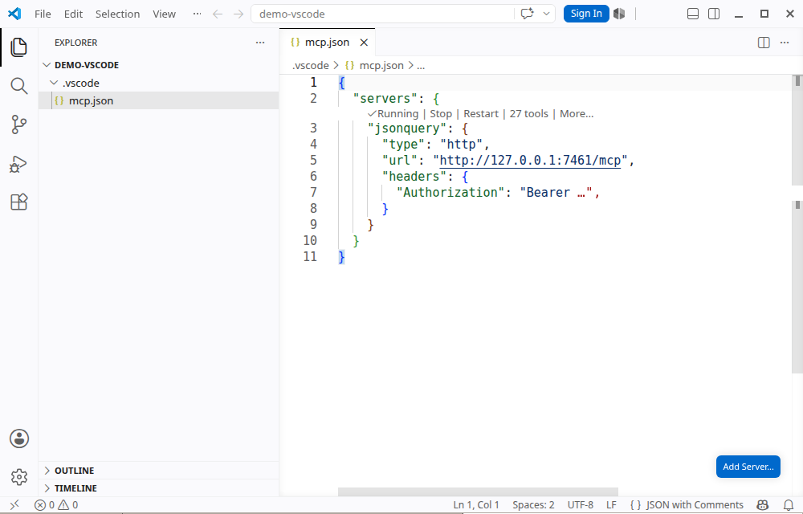
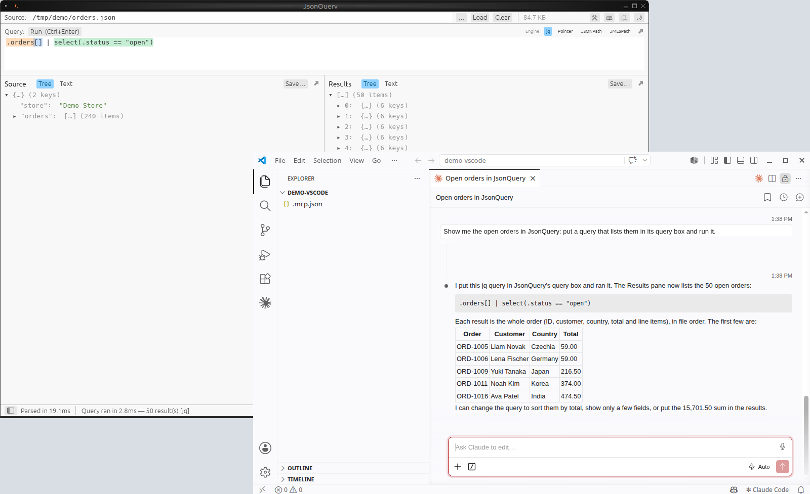
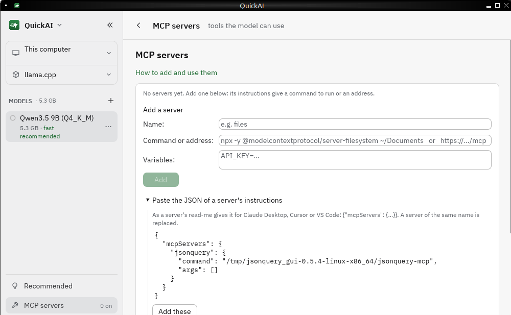
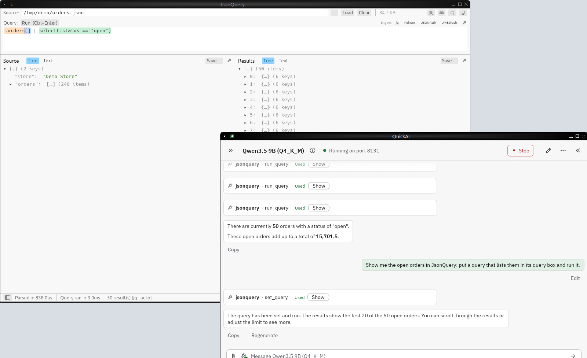

# MCP server

jsonquery gui has a [Model Context Protocol](https://modelcontextprotocol.io) server: an AI
assistant (Claude Code, Claude Desktop, VS Code, Cursor, QuickAI and others) can look at what the
app has open and work with it — read and query the document, put a query in the query box and run
it, open your saved queries — while you watch it happen in the window.

It can also work out of sight — query, read and search any JSON file, use the six Tools (Merge,
Format, Diff, Patch, Validate, Create Schema) — without anything changing in the window, and, if you
allow it, save in the workspace and to files, asking you first, in the app, before anything is
deleted, replaced, written outside the workspace or fetched from the web.

It is in every build: the downloads of each
[GitHub Release](https://github.com/nujufas/jsonquery_gui/releases), the AppImages, and the packages
of the stores and package managers. Nothing of it runs until you start it. For a computer where no
assistant should be able to reach the app, build it without the server (see
[Building it yourself](#building-it-yourself)).

## Starting it

Click the 🔌 at the right of the status bar, then **Start**. The server listens on
`http://127.0.0.1:7457/mcp`, on this computer only, for as long as the app runs; **Stop** stops it
and disconnects every assistant. **Start it with JsonQuery** starts it whenever the app starts.
The button turns green while an assistant works with the app (and for a minute after its last
call), and a spinner turns beside it while a call is being answered; otherwise it is grey, the
server on or not (its tooltip says which). The port can be changed in the panel while the server is stopped.

## Adding it to an assistant

The panel's **Add to** buttons copy what adds the server to one:

| Button | What it copies | Where it goes |
|---|---|---|
| Claude Code | `claude mcp add --transport http jsonquery http://127.0.0.1:7457/mcp --header "Authorization: Bearer …"` | Run it in a terminal |
| Claude Desktop | An `mcpServers` entry that starts `jsonquery-mcp` | `claude_desktop_config.json` |
| VS Code | A `servers` entry of type `http` | VS Code's `mcp.json` (of the user or of a folder) |
| QuickAI | The same `mcpServers` entry | QuickAI's **MCP servers**: *Paste the JSON of a server's instructions* ([quickai.everybodyai.dev](https://quickai.everybodyai.dev)) |
| JSON | An `mcpServers` entry of type `http` | A project's `.mcp.json` (Claude Code), Cursor's `mcp.json`, and other assistants |

What an assistant connects with over HTTP carries the token: keep it to yourself.

Claude Desktop and QuickAI start their servers themselves and
talk to them over stdin and stdout. For them JsonQuery has **jsonquery-mcp** beside the app: it
answers the handshake and the list of tools itself, and takes each call to the app that is running,
with the address and token it reads from `mcp.json` (so what they are given holds no token). The
tools are listed even while the app is closed; a call made then says what to do.

What their buttons copy starts it the way JsonQuery was installed:

| Installed from | What starts `jsonquery-mcp` |
|---|---|
| A tar.gz or a zip, the AUR, Scoop, winget, Chocolatey | its path, beside the app |
| Homebrew | `…/bin/jsonquery-mcp`, Homebrew's link to it, which an upgrade does not move |
| An AppImage | the AppImage itself, with `mcp` first: it then starts the program inside |
| The Snap Store | `/snap/bin/jsonquery-gui.jsonquery-mcp`, the snap's command for it |

Copy it again after you move the app or the AppImage, or after an upgrade puts the app in a folder of
its new version. The buttons are greyed out when `jsonquery-mcp` is not beside the app: in the
Microsoft Store's package, and in a build of the app alone.

### Claude Code

Run the command that the **Claude Code** button copies in a terminal: `claude mcp list` then says
`jsonquery: http://127.0.0.1:7457/mcp (HTTP) - ✓ Connected`, and Claude Code has the tools.



### VS Code

Put the entry that the **VS Code** button copies in VS Code's `mcp.json` (your own, or a folder's
`.vscode/mcp.json`) and press **Start** above it: VS Code says that it runs, and how many tools it
has.



That entry is for GitHub Copilot's chat. The Claude Code extension in VS Code takes a folder's
`.mcp.json` instead: the **JSON** button's entry, or the **Claude Code** button's command run in the
folder.



### QuickAI

QuickAI runs the model on your own computer, so your documents stay on it. The **QuickAI** button
copies the entry; in QuickAI's **MCP servers**, open *Paste the JSON of a server's instructions*,
paste it, and press **Add these**.



JsonQuery's tools need a capable model: **Qwen3.5-9B-Q4_K_M or better** (a bigger model, or one
less quantized), with a good context length: **32K tokens or more**. The tools take about 7K tokens
before the first question, and an answer up to 6K more with **Answers** at 24 KB; with a smaller
context, choose Answers of 8 KB in the panel.



## What the assistant may do

The panel's **Allow** says how far the assistant may go:

- **Read** (the default): look at the open document, the query in the query box and its results,
  and the workspace, and work on them out of sight — run queries, read, search, describe, use the
  six Tools. Nothing you see changes, and nothing is written.
- **Edit**: also open a document (a file, or JSON text), put a query in the query box and run it,
  show a value in the trees, open an item of the workspace, fill a page of the Tools and run it, read
  JSON files that are not open, save items in the workspace, make folders, move, rename and delete
  there, save a file, and load a document from a web address. **You are asked first**, in a dialog
  over the main window, before anything is deleted, an item is replaced, a file is written outside
  the workspace, or a web address is fetched: **Allow**, **Always allow** or **Don't allow**
  (Escape). A question that is not answered within two minutes is refused. Saving a new item,
  making a folder and moving one (nothing is replaced by a move) are not asked about.
- **Always allow** (beside Edit in the panel, or the question's own button): what Edit allows is
  done without asking. Untick it in the panel to be asked again.

A call that needs more than you allow is refused, and the assistant is told to ask you. With Read,
the server never writes or deletes a file, never changes the workspace or the window, and never
loads a web address.

## The tools

| Tool | What it does | Needs |
|---|---|---|
| `get_state` | What the app has open: the document, the query and how it went, what is in front, the workspace | Read |
| `document_info` | Facts about a document without its data: where it is from, its size, when it changed, JSON or NDJSON, how many values of each kind and how deep, its longest arrays, widest objects and biggest members, and how many pages reading it whole takes | Read |
| `describe` | The shape of a value without its data: keys and their kinds, lengths, ranges, example strings, from a sample of long arrays | Read |
| `read_value` | The value at a JSON Pointer, a page at a time | Read |
| `search` | The values and keys that contain a text (or match a regular expression), with their pointers | Read |
| `run_query` | Run a query (jq, JSONPath, JMESPath, JSON Pointer) and get its results a page at a time, without changing what you see | Read |
| `get_results` | A page of the results you see | Read |
| `query_help` | The app's lessons on each language, and where its jq differs from jq | Read |
| `workspace_list` | Your saved queries, schemas, patches, documents and web addresses | Read |
| `workspace_read` | What an item holds, and its sample | Read |
| `format_json` | Format a value as the Format tool does (indent, sorted keys, ASCII) | Read |
| `diff_documents` | Compare two values as the Diff tool does: the differences with their pointers, and the JSON Patch | Read |
| `apply_patch` | Apply a JSON Patch or a JSON Merge Patch and give the result | Read |
| `merge_documents` | Merge values as the Merge tool does (append, unique, deep, bundle, or a jq filter) | Read |
| `validate_json` | Check a value against a JSON Schema: valid or not, and each problem with its pointer | Read |
| `create_schema` | Make a JSON Schema from a value, as Create Schema does | Read |
| `open_document` | Open a file or JSON text as the Source | Edit |
| `set_query` | Put a query in the query box and run it | Edit |
| `reveal` | Open a tree down to a value and show it | Edit |
| `workspace_open` | Open an item as a click on it does | Edit |
| `show_in_tool` | Fill a page of the Tools with values and run it, for you to see | Edit |
| `workspace_save` | Save a query, schema, patch, document or web address in the workspace (replacing one: asked) | Edit |
| `workspace_new_folder` | Make a folder in the workspace | Edit |
| `workspace_move` | Move or rename an item or a folder (nothing is replaced) | Edit |
| `workspace_delete` | Delete an item or a folder (asked) | Edit |
| `save_file` | Save JSON to a file, indented as asked (asked) | Edit |
| `open_url` | Load a document from a web address as the Source (asked) | Edit |

## Out of sight

The tools that only read change nothing you see: only the panel's list of calls shows them. They
take any document as their `input`:

- `"document"` (the one open, the default), `"results"` (those you see);
- `{"file": "/full/path.json"}` — read for the assistant alone (it needs Edit): the window keeps its
  own document;
- `{"workspace": "orders/late.json"}` — a JSON item of the workspace;
- the JSON itself, or its text (`{"json": …}` and `{"text": "…"}` say the same);
- `"last"` — what the assistant's last `run_query` (all of its results, up to 16 MB of them),
  `apply_patch`, `merge_documents`, `create_schema` or `diff_documents` (with `as_patch`) made, kept
  by the app while the server runs: so that a big result is read a page at a time, queried, checked
  or saved (`save_file`, `workspace_save`) without passing through the conversation.

## What a model gives

A model reads a few words of each tool and gives what it means the way it finds easiest. The server
takes it as it is meant:

- The JSON itself, the JSON as text, or a JSON file's full path (`/home/me/data.json`, read as
  `{"file": …}` is), wherever a tool takes a document.
- An argument by another name: `filter`, `expression` or `text` for `query`, `lang` for `language`, `data`,
  `json` or `document` for `input`, `old` and `new` for `left` and `right`, `overwrite` for `replace`,
  `type` for `kind`; and the arguments of a call sent as JSON text.
- `workspace_save` without a `kind`: the ending of the name says it (`late.jq`, `orders.schema.json`,
  `feed.url`), or else what is saved does (a web address, a query's text, a schema with `$schema`, a
  list of patch operations, or a document); an item given by `folder` and `name` instead of `path`.
- `open_document` given the JSON itself (or a JSON file's full path) as its `text`; `show_in_tool`
  given a tool by the name of the tool that does the same out of sight (`validate_json`) or by another
  name (`compare`, `make schema`).

What it still cannot do is said, and the message ends with a call of that tool that works, for the
model to make its next call right.

The six Tools work to the same size limits as the Tools window (⚙ Settings); `show_in_tool` is the
one that shows you a page of them (a box of a page takes up to 1 MB).

## Large documents, and models with a small context

Every answer is at most a page, of the size the panel's **Answers** says: 24 KB by default (about
6,000 tokens of a model), 4 KB to 200 KB. A model that runs on your own computer has a small
context: a smaller page keeps it from filling. Where there is more, the answer says `next_offset`,
and the assistant asks again with `offset`; `limit` caps how many items a page has (20 by default).
`describe` goes fewer levels down if more would not fit, and says so; the help comes in pages too.

### A snippet, and the notice that says so

A model that wants a document asks for all of it as often as not: `read_value` with no pointer,
`run_query` with `.`, `format_json`, the results you see, an item of the workspace. A big one would
not fit in its context, and often holds arrays of thousands of items. So a value too big for a page
is given as a **snippet** of it, made the same way by every tool:

- an array gives its first items (the first one cut down too, if it alone is too big);
- an object gives its small members whole, and shares the room that is left among its big ones,
  each cut down the same way;
- a long string gives its start;
- a part with no room left is `{"$omitted": "array with 120000 items", "pointer": "/users"}`, and
  the items (or members) after the last one given are
  `{"$more": "119782 more items", "pointer": "/users", "offset": 218}`.

`format_json` formats the snippet, so its text is JSON too; `save_file` writes all of it.

And the answer says so, in the same words in every tool, in its member `snippet`:

```json
"snippet": {
  "note": "Large: people.json takes 11.6 MB as JSON, about 2.9M tokens: 485 pages of 24000 bytes. It holds arrays: the biggest, at \"/users\", has 120000 items, 218 of them given here. `members` holds a snippet of it, not all of it. Do not ask for all of it: it would not fit. `next` reads on from where the snippet stops; read_value reads any part by its pointer, a page at a time; run_query picks, filters or counts what you need; describe gives its shape.",
  "in": "members",
  "of": "people.json",
  "is": "object with 2 members",
  "bytes": 11626720,
  "size": "11.6 MB",
  "tokens_about": 2906680,
  "arrays": [{"pointer": "/users", "items": 120000, "given": 218, "next_offset": 218}],
  "objects": [{"pointer": "", "members": 2, "given": 1, "next_offset": 1}],
  "next": {"tool": "read_value", "arguments": {"input": "document", "pointer": "", "offset": 1}}
}
```

That is `read_value` with no pointer, of a file of 120,000 users and a little more, with the page
of 24 KB: the answer gives the first 218 users and ends them with
`{"$more": "119782 more items", "pointer": "/users", "offset": 218}`; it reads the document a
member at a time, so `next` is its next member, and `arrays` says where the users go on.

| Member | What it says |
|---|---|
| `note` | That it is large and how large, the biggest array (or object) not given whole, that this is a snippet and not all of it, and how to go on |
| `in` | The member of the answer that holds the snippet: `items`, `members`, `value`, `result`, `schema`, `patch`, `text`, `content`, `sample` |
| `of`, `pointer`, `is` | What it is a snippet of, where in it (none: all of it), and what it is |
| `bytes`, `size`, `tokens_about` | How big all of it is, as JSON (`at_least`: no less than that) |
| `arrays`, `objects` | The arrays (and objects) not given whole, the biggest first: how many items each has, how many are given, and the offset to read on from |
| `strings_cut` | How many strings are given only by their start |
| `next` | A call that reads on from where the snippet stops, ready to make: `read_value` on the same document, or on `"last"` for what a tool made or a query gave (kept there), or `run_query` again from the next result for results too many to keep; none where there is no such call (the JSON given in the call) |

What fits in a page is given whole, and nothing is said. `workspace_read` with `sample` gives the
sample's notice as `sample_snippet` (a sample is read on by its own path, `{"workspace": "…"}`).
`get_state`, `open_document` and `document_info` say of a document too big for a page that it is
`large`, in the same words, before anything is read.

`document_info` and `describe` are how an assistant learns a large document before it reads it: the
first counts what is in it (for up to 10 seconds; it says if it counted only a part) and says where
the bulk of it is and how many pages reading it whole would take; the second gives its shape from a
sample, and looks at no more than 50,000 values however big the document is. Both work the same on a
document that is kept on disk (256 MB and over by default).

What a model reads of the tools before it does anything — their descriptions and what they take — is
about 19 KB.

The assistant's own queries (`run_query`, `search`) run on a worker of their own, over the document
the app already holds, so they never wait behind yours, nor yours behind them; one is stopped after
`timeout_ms` (30 seconds by default). A call that changes what the app shows works while the window
is minimized or covered.

## Safety

- The server listens on `127.0.0.1` only. It answers only requests that name it as their host, that
  come from no web page, and that carry its token (`Authorization: Bearer`): what keeps other
  programs on the computer, and web pages, from using it.
- The token, the port and the panel's choices are kept in `mcp.json`, beside `settings.json` (in
  `.jsonquery` of your home, or the folder `JSONQUERY_HOME` names), which only you can read. **New token** makes another:
  assistants set up with the old one must be added again (`jsonquery-mcp` follows it by itself).
- A JSON document can hold text written to steer an AI ("prompt injection"). With **Read** the
  assistant can change nothing; with **Edit** it can open files and write, and what deletes,
  replaces, writes outside the workspace or reaches the web waits for your Allow — unless you tick
  **Always allow**, which is best kept for documents you trust.
- The panel lists the last calls: the tool, how long it took, and the error of one that failed.

What the assistant reads through the server goes to the assistant, and so to whoever runs its model
(see [PRIVACY.md](../PRIVACY.md)).

## Versions of the protocol

The server speaks MCP 2024-11-05 to 2025-11-25 (the `initialize` handshake) over Streamable HTTP,
without sessions: an assistant that was connected before the app was restarted goes on as it was. A
client of a later version (2026-07-28) is answered with the versions the server speaks, and falls
back to the handshake. `jsonquery-mcp` speaks the same over stdin and stdout.

## Building it yourself

```sh
cargo build --release -p jsonquery_gui -p jsonquery-mcp
# target/release/jsonquery_gui, with the server, and target/release/jsonquery-mcp beside it
```

The server is the app's cargo feature `mcp`, a default one. Without it:

```sh
cargo build --release -p jsonquery_gui --no-default-features
```
