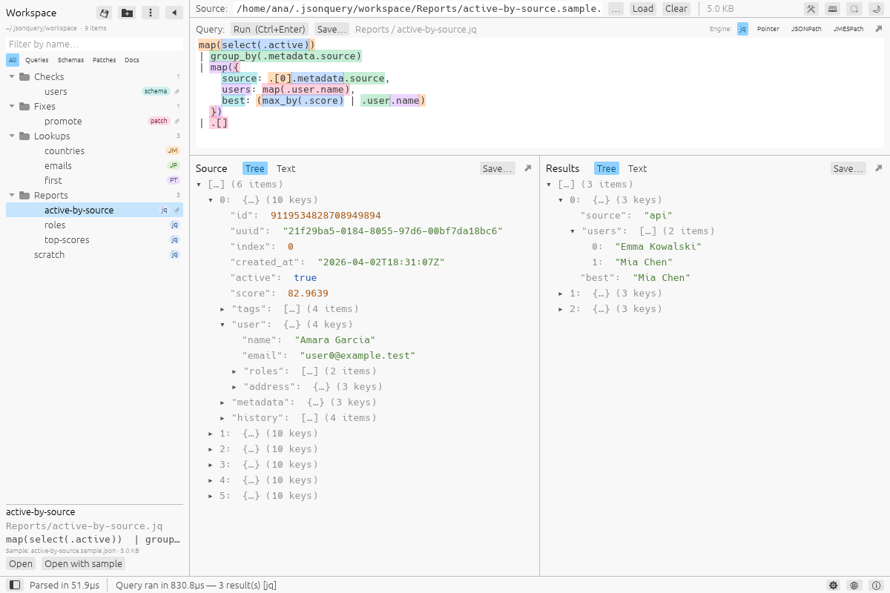
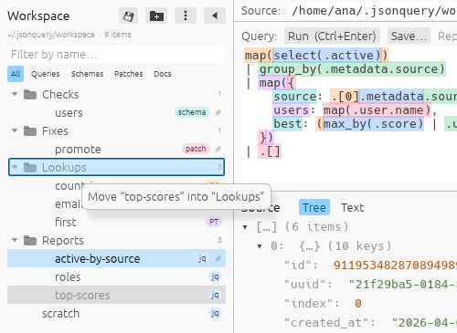

# Workspace

Your own queries, schemas, patches and documents, each with a sample if you want
one, kept in folders you make, to come back to. The **workspace** is a folder on
your computer — an ordinary one, with folders and files in it — and the **pane** at
the left of the window is how you look through it.

Nothing is sent anywhere, and nothing is kept that you did not save: a query you
type is forgotten when you close the app, as it always was, until you save it here.



## Showing the pane

The **button at the left end of the status bar**, under the pane it is for, shows the
pane and hides it again (it is a window with its left column filled, dim while the
pane is not shown); the status text is after it. Until you show it the window is
exactly what it has always been.

Shown, the pane is at the left of the window, from the top to the status bar, or, with
the Tools docked, under the row of tabs. **◀** in its header folds it to a thin strip
with one button, **▶**, that opens it again; its right edge can be dragged to make it
wider or narrower (not narrower than 208 points, which its title and buttons need,
nor wider than half of the window). How it was left — hidden, open or folded, and how wide — is kept
for the next run (see [Settings](settings.md)). In a window narrower than 900 points
only the strip is shown, because there is no room beside it.

## What is in the pane

- **The header** has **💾**, which saves the query that is in the box (more below),
  a button for a **new folder** (a folder with a plus), the **⋮ menu** (import,
  export, where the workspace is) and **◀**.
- **A line** says where the workspace is (hover it for the whole path) and how many
  items there are in it; a **⚠** after it is the notes of the last time the folder was
  read (a file that could not be read, a link that is not followed).
- **A filter** narrows the list to the items whose name, or whose folder's name,
  has what you type; the **chips** narrow it to one sort of item: *All*, *Queries*,
  *Schemas*, *Patches* or *Docs*. With the Tools docked, the chips follow the page in
  front: *Schemas* on **Validate Schema**, *Patches* on **Patch JSON**, *All* on **Json
  Query**.
- **The list** has the folders first, each with how many items are in it, and the
  items under them. A tag says what an item is (`jq`, `JP` for JSONPath, `JM` for
  JMESPath, `PT` for JSON Pointer, `schema`, `patch`, `json`), and a paperclip that
  it has a sample.
- **The item that is picked** is under the list: its name, its file, its first
  lines, its sample, and the buttons that open it.

## What an item is, and where it goes

| An item is | Its file ends in | *Open* puts it |
|---|---|---|
| a query | `.jq`, `.jsonpath`, `.jmespath`, `.jsonptr` | in the query box, and the language of the box is the one the end says |
| a schema | `.schema.json` | in the **Schema** box of Validate Schema, whose page is shown |
| a patch | `.patch.json` | in the **Patch** box of Patch JSON, whose page is shown |
| a document | `.json`, `.ndjson`, `.jsonl` | as the Source (a document has no sample) |

*Open with sample* does the same and opens the item's **sample** as well: as the
Source for a query, which is then run; in the **Document** box for a schema or a
patch, which is then validated or applied. Nothing replaces what is in a box until
you open something: a click only picks. (**Ctrl+Z** in the query box brings back the
text that an open replaced.)

A click picks a folder or an item (a click on a folder also opens or shuts it), a
double click on an item opens it, and a **right click** has the menu: *Open*, *Open
with sample*, *Rename*, *Duplicate*, *Move to*, *Copy text*, *Show in the file
manager* and *Delete…* (which asks first); a folder's has *Save the query here…*,
*New folder…*, *Rename*, *Move to*, *Import into this folder…*, *Export this
folder…*, *Show in the file manager* and *Delete…*. *Rename* is done in the list:
type the new name and press Enter.

### Moving by dragging

Drag a row with the mouse onto a folder to move it there: an item, with its
sample, or a whole folder, with what is in it. While the row is carried, the folder
it would go into is outlined, and a label beside the pointer says where it would go
(*Move “orders” into “Services”*). Let go, and it is moved; it stays picked in its new
place, and the folder it went into is open, with the message *Moved “orders” into
“Services”* under the list. Let go on an **item** and the row goes into the folder that
item is in; on the **empty part of the list**, to the top of the workspace.



- Holding the row over a **shut folder** for a moment opens it, so that a folder
  inside it can be the place; holding it near the top or the foot of a **long list**
  scrolls the list.
- Nothing is done when the place is the folder the row is in already, when a folder
  would go into itself or into a folder that is in it, or when the row is let go
  outside the list; **Esc** puts the row back. When the name is taken in the folder it
  would go into, that is said under the list and nothing is moved.
- A press that moves only a little is a click, and a double click still opens an item.
  Only the main button carries a row, and the row that is being renamed is not carried.
- The item is the same item after it moves: its id and its SHA-256 (below) are kept,
  and so is what the Query row says, *from the workspace*. *Move to* in the menu of a
  row does the same without the mouse (a folder that the row cannot go into is dim).

### Opening a query by dragging or dropping it

- **Drag a query out of the list onto the query pane**: the pane is outlined, a label
  beside the pointer says *Open “logins” as the query*, and let go, it is opened as a
  double click on it opens it (its language is chosen, and the Query row says where it
  came from). Nothing is moved. A schema, a patch, a document or a folder is not opened
  that way, and is not lit there; **Esc** puts the row back.
- **Drop a query file on the window**: a file whose name ends in `.jq`, `.jsonpath`,
  `.jmespath` or `.jsonptr`, from the file manager or from anywhere, goes in the query
  box, in the language that the end says, and the box is outlined while the file is over
  the window. The window is not told *where* in it a file is let go, so it is what the
  file is that says where it goes and not the pane under the pointer: any other file is
  opened as the Source, as it always was (and several files go to Merge). It works in the
  window of a Query pane that was popped out too. A file that is in the workspace's own
  folder is known as the item it is. One that cannot be read, is not text, or is bigger
  than a megabyte is said in the status bar, and the box is as it was; the next query
  file that is used takes what was said away. (**Ctrl+Z** brings back the text that a
  drop replaced.)

## Saving

**💾** in the pane, and the **Save…** that the Query row has beside Run while the
pane is shown, open the window that saves (it is the main window's: with the Query
pane in a window of its own, **Save…** is there too, and the main window comes in
front of it with the window that saves):

- **Save** — *the query* (the text of the query box, in the language it runs as),
  *a schema* (the Schema box of Validate Schema), *a patch* (the Patch box of Patch
  JSON) or *the Source* (the document that is open, as a document). What the page in
  front is for is what is chosen to begin with; what has nothing in it is greyed.
- **Name** and **Folder**, and, if you want one, **a new folder in it**. A query
  that was opened from the workspace comes back under its own name and folder: the
  button then says **Replace**, and the item keeps its id.
- **Keep … as its sample** — the Source, for a query (up to what the Tools take,
  128 MB unless you changed it in Settings); the Document box of the page, for a
  schema or a patch. The sample is written as the pretty-printed document.

A name may not be empty, longer than 120 letters, start or end with a dot, have any
of `/ \ : * ? " < > |` in it, or be a name that Windows keeps for itself (`CON`,
`NUL`, `COM1`…): the folder may be taken to a computer that has those rules. A name
that differs from another only in its case is the same name, for the same reason.

## Where it is kept

In the folder `workspace` beside the settings: `~/.jsonquery/workspace`
(`%USERPROFILE%\.jsonquery\workspace` on Windows, `$JSONQUERY_HOME/workspace` if
that is set). It is made when you save the first item, and not before.

You can keep it somewhere else — in a folder you share with colleagues, in a
repository: **⋮ → Open another folder as the workspace…** picks the folder. The pane
then shows that one, in place (nothing is copied or moved); the choice is kept in the
settings as one path, and **⋮ → Use the usual workspace** goes back. If the folder
that was chosen is not there (a stick that is out, a folder that was renamed), the
pane says so and offers to choose another or to use the usual one; it does not make
the folder again.

What is in it is files and folders, so a file manager, an editor and `git` work on it
as they do on any folder:

```
workspace/
├── Logs/
│   └── Errors/
│       ├── slow requests.jq               the query
│       └── slow requests.sample.json      its sample
├── Services/
│   ├── orders-api.schema.json             a schema
│   ├── orders-api.sample.json             its sample: the items called `orders-api` share it
│   └── bump replicas.patch.json           a patch
├── scratch.jq
└── .jsonquery/index.json                  see below
```

A file that does not end in one of the ends above, a name that starts with a dot, and
a link are not the workspace's, and are left alone; folders more than 16 deep are not
read. A **sample** is the file `<name>.sample.json` in the folder of the item (the
items of one name in one folder — a query and a schema, say — share it).

### The id and the SHA-256 of each item

Every item has an **id** of its own, and the **SHA-256 of what it holds**; its sample
has a SHA-256 too. They are not shown. They are kept so that what comes later — telling
an item from a copy of it, noticing that it was changed, keeping one workspace in step
with another — has something to go by that does not change when an item is renamed or
moved.

They are in one hidden file, `.jsonquery/index.json` in the workspace's folder, so
that the items themselves stay what other programs expect (a `.jq` file is a jq
program, a `.schema.json` file a JSON Schema):

```json
{
  "format": "jsonquery-workspace",
  "version": 1,
  "items": {
    "Logs/Errors/slow requests.jq": {
      "id": "6f1c0e52-9a4b-4c1e-8d52-3b7a1c9e0f21",
      "sha256": "9f2c…",
      "bytes": 118,
      "modified": 1792528206123,
      "sample": { "sha256": "ab12…", "bytes": 2355, "modified": 1792528206000 }
    }
  }
}
```

- The **id** is a random UUID (version 4), given when the item is first saved or
  first seen, and it stays the same through every rename, move, edit and copy to
  another workspace. A copy made with *Duplicate* is a new item and has an id of its
  own.
- The **sha256** is of the text of the item's file, exactly as it is written, in 64
  lower-case hexadecimal digits. (`bytes` and `modified` are what the file was when
  the SHA-256 was worked out: a file that is the same size and was changed at the
  same time is not read again.)
- The file is made right whenever the folder is read — when the app starts, when the
  window gets the focus back, after anything done in the pane. A file that is **new**
  gets an id. A file that another program **changed** keeps its id, and has a new
  SHA-256. A file that another program **renamed or moved** is found again by its
  SHA-256 and keeps its id. An entry whose file is **gone** is taken out.
- A key that a later version of the app has put in the file is kept when this one
  writes it. An index that cannot be read is set aside as `index.json.bad` and made
  again; one from a newer version is read, and never written over. If the folder
  cannot be written to, the items are listed all the same, but their ids are not kept
  from one run to the next (the ⚠ says so).

## Export and import

**⋮ → Export the workspace…** copies the workspace — or the folder that is picked in
the list — to a folder that is new or empty (never into the workspace, nor into a
folder that has it inside). The **samples** can be left out: a sample is real data,
and you may not want to hand it to a colleague. What is written is the same files in
the same folders, and the index, so that every item keeps its id and its SHA-256
where it goes; the folder is a workspace that can be opened as one.

**⋮ → Import a workspace…** copies a folder into the workspace: a workspace that was
exported, or any folder with files of the kinds above in it. Type the folder's path or
pick it with **Choose folder…**; the window reads it when you leave the box (or press
**Import**), tells what is in it (`14 items in 5 folders: 9 queries, 3 schemas…`) or why
it cannot be used, and asks where to put it:

- **in a new folder** of its own in the workspace (named for the folder it comes
  from, unless you type another name; with a number after it if that name is taken),
  which is how an import never touches what is there; or
- **among what is in** a folder of the workspace, and then, for an item whose name
  is taken and which holds something else: **keep both** (the new one gets a number
  after its name), **replace** the one that is there (it keeps its id), or **leave
  the new one out**.

An item that is the very same as the one of that name that is there (it has the same
SHA-256) is not copied again, so importing the same folder twice adds nothing. An item
keeps the id it had, unless that id is in use in the workspace already, and then it is
given another. Nothing is written in the folder that is imported.

## What it takes care of

A file is written whole or not at all (to a file beside it that is then renamed into
place); nothing is written through a link; a name that is taken is not taken over
unless *Replace* was asked for; a folder that is deleted loses only the items, the
samples and the folders that the workspace itself made, and one that holds other
files keeps them, and itself; and everything that is done is done in the workspace's
own folder, whatever name was typed.
